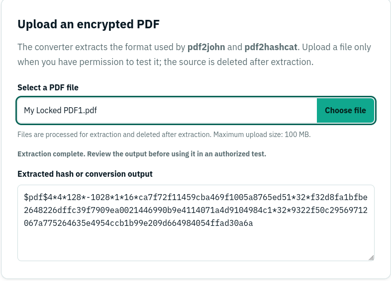
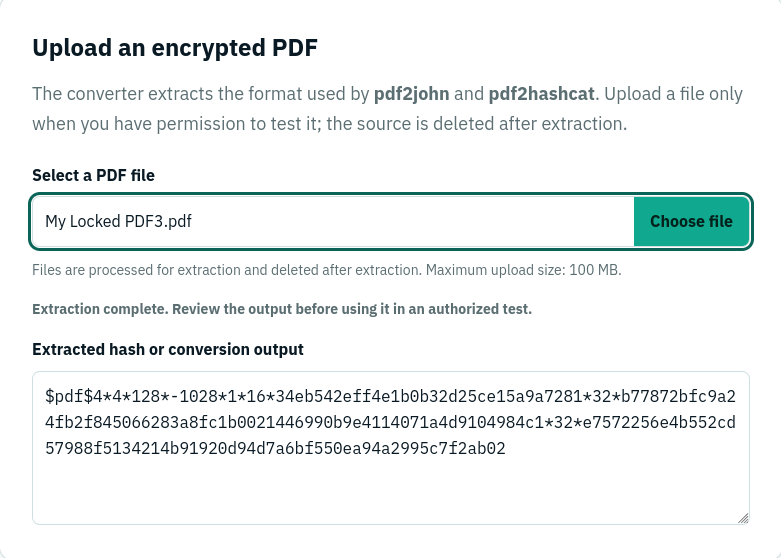
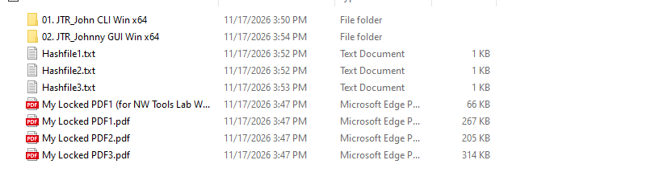
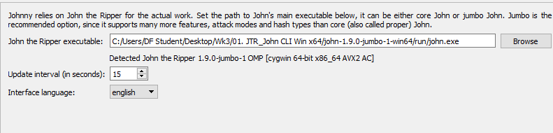
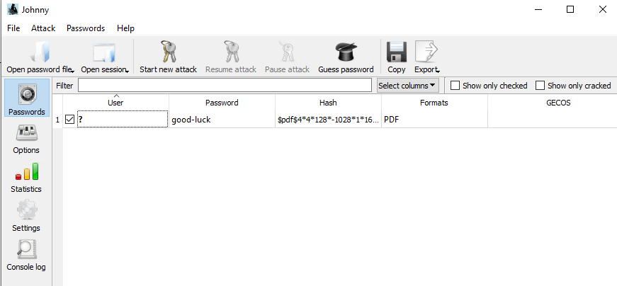
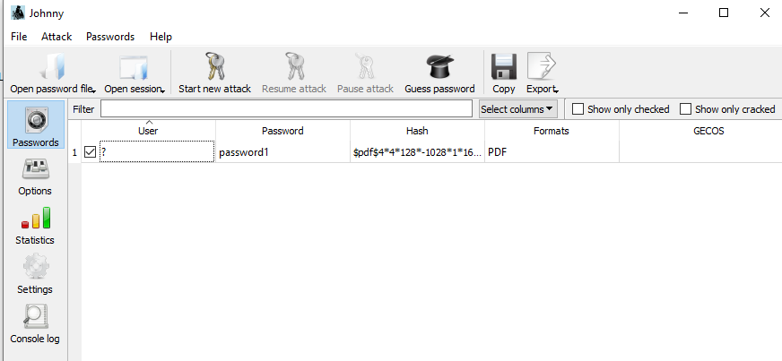
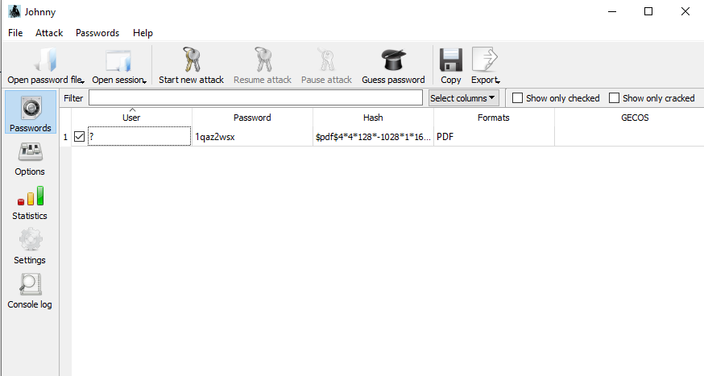
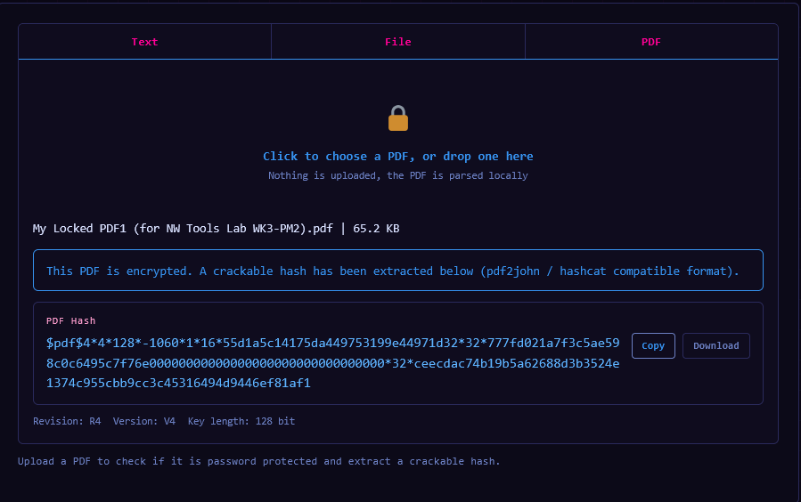
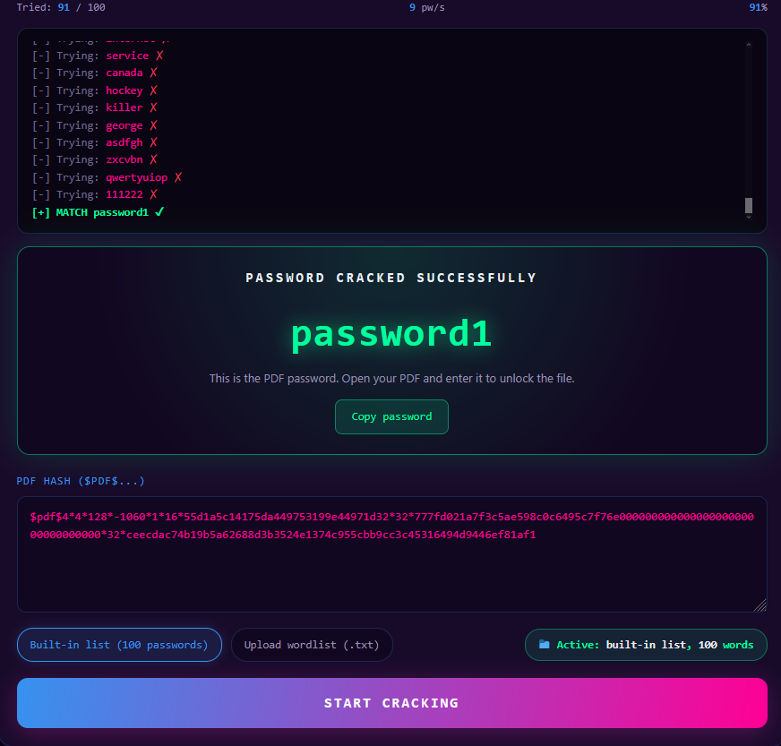

# NETWORKWALKS-B084-WEEK3-PM1-2
NetworkWalks B084 Week 3 – Password auditing and recovery of encrypted PDF files using John the Ripper, Johnny GUI, hash extraction and wordlist attacks.

## Project Overview

This project focuses on password auditing and recovery of encrypted PDF files as part of the NetworkWalks Cybersecurity Internship Program (B084).

The activities involved extracting PDF password hashes, configuring John the Ripper through Johnny GUI, and performing dictionary-based password attacks. The second project module involved using NetworkWalks' online password recovery tool to extract and test PDF password hashes.

These exercises demonstrate how weak or predictable passwords can compromise password-protected documents.

## Objectives

- Extract password hashes from encrypted PDF documents.
- Configure John the Ripper using Johnny GUI.
- Perform dictionary-based password recovery.
- Use NetworkWalks' online password recovery tool.
- Recover passwords from protected PDF files.
- Understand the risks associated with weak passwords.

## Tools Used

- Windows 10 VM
- John the Ripper Jumbo
- Johnny GUI
- PDF hash extraction tools
- Password wordlists
- NetworkWalks Online Password Recovery Tool

# Project Module 1 (PM1) – John the Ripper

## 1. PDF Hash Extraction

Three password-protected PDF files were used for the first project module.

Before attempting password recovery, I extracted the password verification data from each document using a PDF hash extraction tool.

The extracted outputs were saved as `Hashfile1.txt`, `Hashfile2.txt` and `Hashfile3.txt` for use with John the Ripper.

*Figure 1: Extracted password hash from PDF 1.*

*Figure 2: Extracted password hash from PDF 2.*

*Figure 3: Extracted password hash from PDF 3.*

*Figure 4: Working directory containing the encrypted PDF files, extracted hashes and tools.*

## 2. John the Ripper Configuration

I configured Johnny GUI to use the John the Ripper executable from the downloaded John the Ripper Jumbo directory.

Johnny provides a graphical interface for John the Ripper, making it easier to load password hashes and manage password recovery attempts.

The configuration successfully detected John the Ripper version `1.9.0-jumbo-1`.

*Figure 5: Johnny GUI configured with the John the Ripper executable.*

## 3. Password Recovery

After loading the extracted hashes into Johnny GUI, password recovery was performed against the three PDF documents.

The following passwords were successfully recovered:

| PDF File | Recovered Password | Result |
|---|---|---|
| PDF 1 | `good-luck` | Successful |
| PDF 2 | `password1` | Successful |
| PDF 3 | `1qaz2wsx` | Successful |

*Figure 6: Successful recovery of the password "good-luck".*

*Figure 7: Successful recovery of the password "password1".*

*Figure 8: Successful recovery of the password "1qaz2wsx".*

All three passwords were recovered, demonstrating how predictable passwords can be identified through password-guessing attacks.

# Project Module 2 (PM2) – NetworkWalks Online Tool

## 4. Online PDF Hash Extraction

For the second project module, I used NetworkWalks' online PDF password recovery tool.

The tool allowed me to upload an encrypted PDF file and extract its password verification data through a browser interface.

The extracted output was displayed in a format compatible with password recovery tools such as John the Ripper.

*Figure 9: NetworkWalks online tool extracting password verification data from an encrypted PDF.*

## 5. Online Password Recovery

After extracting the PDF password hash, I used the online password recovery interface to perform a dictionary-based attack.

The interface provided a built-in list containing 100 candidate passwords, along with an option to upload a custom wordlist.

During the test, the tool successfully identified the password `password1`, demonstrating how common passwords can be recovered using a relatively small wordlist.

*Figure 10: NetworkWalks online tool successfully recovering the password "password1".*

## 6. Flag Capture

After successfully completing the password recovery activities, NetworkWalks provided completion flags as evidence of successful testing.

The following screenshots demonstrate the captured flags.

*Figure 11: NetworkWalks password recovery completion flag.*

*Figure 12: NetworkWalks additional password recovery completion flag.*

*Figure 13: NetworkWalks final completion flag.*

# Results and Lessons Learned

## 7. Results

Both project modules were completed successfully.

**PM1 – John the Ripper:**
- Extracted PDF password hashes from three encrypted files.
- Configured John the Ripper through Johnny GUI.
- Successfully recovered all three passwords.

**PM2 – NetworkWalks Online Tool:**
- Extracted PDF password verification data using the online interface.
- Conducted dictionary-based password recovery.
- Successfully recovered the password `password1`.
- Captured the completion flags.

The results demonstrated that weak or commonly used passwords can make encrypted documents vulnerable to password-guessing attacks.

## 8. Lessons Learned

Through these activities, I learned:

- How to extract password verification data from encrypted PDF documents.
- How to configure and use John the Ripper through Johnny GUI.
- How dictionary-based attacks can recover weak passwords.
- How NetworkWalks' online password recovery tool performs password testing.
- Why wordlist selection influences the success of password recovery.
- The importance of strong and unique passwords when protecting sensitive files.

## 9. Conclusion

This week's activities improved my practical understanding of password security and password recovery techniques.

By using both John the Ripper and NetworkWalks' online tool, I gained experience extracting PDF password hashes, performing dictionary-based attacks and interpreting password recovery results.

All activities were conducted against authorised training files within the NetworkWalks Cybersecurity Internship Program (B084).

## Author Information

**Ali Fares**  
Cybersecurity Intern – NetworkWalks B084  

**Project:** Week 3 – PM1 & PM2  
